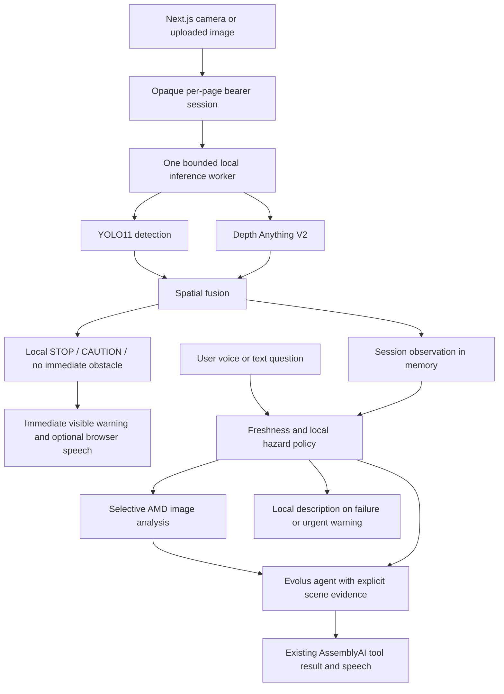

# EchoSight architecture and API contracts

## Existing repository findings

The application already had working upload, WebSocket, scene-fusion, navigation and AssemblyAI paths. `main.py` combined inference and API handlers; `page.tsx` combined browser audio, camera and UI. The new services were empty. Confirmed problems were a person/vehicle-only obstacle filter, a global scene cache and shared frame filename, a 60-second cache for navigation, synchronous work in async handlers, and a frontend busy flag that remained set after a valid JSON error response. The video element also mounted after its initial stream assignment, so starting a camera could leave the element without a stream.

The existing endpoints and `(scene, decision)` inference return contract are preserved. `update_latest_scene` now requires an explicit session and observation. The standalone PyAudio service remains an optional local client; the web application uses browser audio and does not install PyAudio on Railway. Desktop callers must pass a valid explicit session to `handle_voice_command`; there is no shared default camera.

## Verified provider contracts

Verified against first-party documentation on October 18, 2026:

| Service | Contract | Source |
| --- | --- | --- |
| AMD Radeon Token Factory | `POST {AMD_TOKEN_FACTORY_BASE_URL}/chat/completions`, `Authorization: Bearer <key>`; exact configured `model`; `messages[].content` text and `image_url: {url: "data:image/jpeg;base64,..."}` parts; `choices[0].message.content` output | [Chat completions](https://amd-aim.github.io/radeon-cloud-docs/api/chat-completions/), [Vision model](https://amd-aim.github.io/radeon-cloud-docs/models/deepseek-v4-flash-vision-exp/), [Model catalog](https://amd-aim.github.io/radeon-cloud-docs/models/overview/) |
| Evolus Specialized Agent | `GET {EVOLUS_BASE_URL}/v1/models`; `POST {EVOLUS_BASE_URL}/v1/chat/completions`; Bearer application API key; `model` is **applicationId:agentId**; message content is a text string; standard Chat Completions output | [Evolus developer guide, Agent chat](https://evolus.ai/en/developers) |
| AssemblyAI Voice Agent | Existing token/WebSocket/PCM16 24-kHz contracts; interactive function results wait for matching `reply.done`, use JSON string `result`, and clear on interruption. Tool timeout is 40 seconds, above the bounded cloud budget. Clean disconnect sends `session.end`. | [WebSocket events](https://www.assemblyai.com/docs/voice-agents/voice-agent-api/events-reference), [Tools](https://www.assemblyai.com/docs/voice-agents/voice-agent-api/tools/overview) |

AMD supports `response_format: {"type":"json_object"}`. EchoSight requests a summary, observations and uncertainty inside that JSON. This inner format is an application prompt contract, not an invented provider endpoint or provider response field. Truncated, malformed and empty output fails closed. Images are validated, normalized, stripped of EXIF, compressed and padded as needed. The configured model is never silently replaced.

Evolus's developer guide distinguishes the REST headers `X-ApiKey`/`X-Application-Id` from its Bearer-authenticated agent-chat interface. EchoSight uses the latter, verifies the exact application/agent combination against `/v1/models`, and does not use or guess REST routing fields. The JSON answer/evidence structure is requested in the prompt, not sent as an undocumented API option. Agent temperature and underlying model routing remain configured in Evolus. The app does not claim which coordinator/reasoner aliases the agent used.

Evolus documents `X-Conversation-Id` for continuing history. EchoSight deliberately omits it, sending a complete fresh scene context with each request. This prevents stale camera history or one user's conversation being reused for another. Pronoun-only follow-up questions may require clarification.

The configured old agent ID returned 404. After the user's explicit selection, only `EVOLUS_AGENT_ID` in the ignored local `.env` was changed to the existing **EchoSight Accessibility Assistant**. The application ID and API keys were preserved. The selected agent reports model display name `EchoSightCoordinator`, state `ok`, and zero configured sub-agents; underlying per-request model execution beyond the documented agent route was not exposed. Its application/agent combination was verified in the live `/v1/models` list. It is not presented as a differently named Spatial Intelligence Agent.

## Browser/backend contract

1. `POST /api/session` creates a cryptographically random bearer token. It is held only in the current page's memory.
2. HTTP scene, upload, enrichment and voice-token requests send `X-EchoSight-Session`.
3. `/ws/vision` authenticates with a first message `{"type":"session","session_id":"..."}`. The server returns `{"type":"session_ready"}`. Tokens never enter WebSocket query strings or access logs.
4. Existing `{"type":"frame","image":"<base64>"}` and `vision_result` schemas remain. Results add `observation_id`, `source`, `age_seconds`, `navigation_valid_for_seconds` and `depth_available`.
5. Upload returns local analysis immediately. The frontend subsequently calls `POST /api/vision/enrich` with `observation_id`. A superseded upload result cannot replace the latest view.
6. `/api/voice/analyze` still accepts `{"command":"..."}` and returns `{"type":"tool_result","result":"<serialized JSON>"}`. Existing `answer`, `scene`, `navigation` and `description` keys remain. Cloud metadata and evidence are additive. The AssemblyAI tool callback continues returning the existing serialized tool result. It queues results until the matching reply completes, correlating the actual `reply.started`/`reply.done` identifiers. Live testing returned ordinary reply IDs rather than the documentation's `fc-<call_id>` form; both are supported and covered by tests.
7. `GET /api/vision/test` reanalyzes only that session's image and preserves its original capture time. It cannot make stale observations fresh.

Navigation asks use observations no more than five seconds old by default. Camera descriptions allow thirty seconds, explicitly labeled if the observation changed during enrichment. Uploaded-image descriptions have a ten-minute window and never establish a live route. Timestamp age includes inference queue time and uses a monotonic clock. The UI expires camera navigation too.

## Failure handling, scheduling and privacy

- One model worker runs YOLO/depth; two accepted inference slots bound its queue. Cancellation never enables simultaneous native inference. Slow inference can make an observation stale; the app then requests a fresher view.
- Depth failure retains detections and produces uncertain-distance guidance. If detection fails, the error is reported and the next frame may retry.
- AMD runs for uploads, detailed questions and questions requiring visual evidence beyond local detections. Evolus runs only on a user request, never continuously. Navigation/crossing questions are answered locally; fresh urgent camera STOP warnings bypass clouds entirely.
- Cloud concurrency is limited to four operations, one operation per session, with a two-second session cooldown. HTTP connections are reused. There are no automatic retries. Provider deadlines are capped at twenty seconds each; an enclosing request budget defaults to thirty seconds and caps at thirty. This intentionally bounds legacy `.env` values of 60/150 seconds.
- Cloud errors expose only application error codes. Metrics record outcome and monotonic elapsed milliseconds without images, prompts, headers, API keys or session tokens. Success metadata is emitted only after a real response passes validation.
- A local STOP/CAUTION remains authoritative. Evolus cannot change the navigation decision. Known unsafe movement claims are rejected. Evidence references are checked, but natural-language grounding and cloud vision remain fallible; evidence references are not proof of a physical fact.
- Frame data, scenes and cloud locks are isolated per session and expire after thirty idle minutes. A periodic cleanup runs every minute. Model input uses random temporary files removed on completion; camera filenames are never derived from client input and images have no public static route. Preexisting legacy upload files are not read by the new session API.
- This is anonymous capability-based access, **not user authentication**. Anyone holding a token can access that session. Protect deployment with HTTPS, trusted origins, rate limits and account authentication where needed. CORS/Origin checks are not authentication. A token is lost on page reload. Sessions live in one process: run **one ASGI worker**; multiple workers/replicas need a shared authenticated session store or sticky routing. Maximum 200 sessions limits retained images. Large request-body limits should also be set at the reverse proxy.
